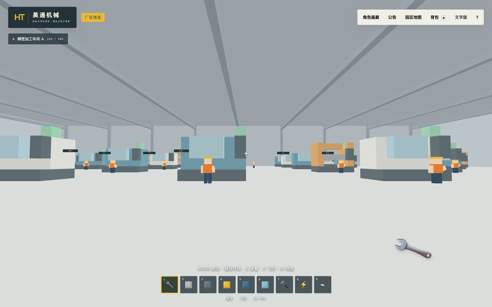

# E0 引擎对比与本地预览（2026-10-08）

## 当前结论与决策点

推荐 **Three.js + Worker**，理由是代码包与主线程 JS 堆较小、区块网格化在后台线程进行，中文界面和工业实体容易继续扩展。推荐并非已证明比 ClassiCube 帧率更高：三种方案在本机均约 60 FPS，尚未做指定手机真机及 4G 验收。

本次实际完成 **两个新候选 + 一个原引擎基线**。Luanti、DVE、Voxelize 只做资料筛选，没有写入虚构实测。规划书建议至少三个新候选及真机，本次未全部满足这一建议；目前两套候选足够进行可玩性比较，如需扩大选型范围应在定案前补充。

根据 [MASTER_PLAN.md 第 4.4 节](MASTER_PLAN.md)：

> 出一张对比表 + 截图发给用户，**由用户拍板**。

因此新预览仍标记为 E0，未擅自确定正式引擎或替换线上。接下来需要用户选择轻量方案或 noa，再推进 E1/P1–P6；总部暂按 80 格，可在后续改成 90 格。

## 查看与复现

当前本机静态服务：

- [引擎对比页](http://127.0.0.1:8790/compare.html)
- [轻量方案试玩](http://127.0.0.1:8790/?engine=three)
- [noa 方案试玩](http://127.0.0.1:8790/?engine=noa)
- [原引擎基线](http://127.0.0.1:8790/benchmark/classic.html)
- [独立文字版](http://127.0.0.1:8790/text.html)

服务退出后按 [v2/README.md](../../blockworld/v2/README.md) 重新启动。源码在 `blockworld/v2/`，所有产物为可静态托管文件；没有新增常驻游戏服务器。没有 commit、push 或远程部署，旧站与 `dist_prod` 保持原状。

测量运行 `npm run measure`。支持 `HT_MEASURE_ENGINE=three|noa|classic` 只更新一个方案的两种模式。原始记录为 [results.json](../../blockworld/v2/public/benchmark/results.json)，截图保存于 `blockworld/v2/public/benchmark/shots/` 与 `output/playwright/`。

## 实测

环境：Apple M5 Pro、macOS 27、Chromium 155 无头浏览器，ANGLE Metal；localhost，无网络或 CPU 限速。桌面 1440×900，手机采用同一台 Mac 的 915×412 横屏触摸模拟，不能当成 iPhone 12 / 中端 Android 的真机成绩。

每项一个空缓存的新上下文。入口区块稳定后采样 10 秒（600 帧），加工车间采样 6 秒（360 帧）；没有重复多轮取统计置信区间。两个新候选使用相同 FOV 68°、视距、32 格区块、控制和实体预算，桌面 64、手机 24。测量中控制台和页面运行错误均为 0。

| 方案 | 模式 | 出生区可操作 | 平均帧率 | 帧耗时 P95 | 主线程 JS 堆 | 资源请求量 |
|---|---|---:|---:|---:|---:|---:|
| Three.js + Worker | 桌面 | 113 ms | 60 FPS | 17 ms | 8 MB | 3.98 MB |
| noa 0.33.0 + Babylon.js 6.49.0 | 桌面 | 145 ms | 60 FPS | 17 ms | 35 MB | 4.62 MB |
| ClassiCube 1.3.8 基线 | 桌面 | 160 ms | 60 FPS | 17 ms | 4 MB | 0.68 MB |
| Three.js + Worker | 手机模拟 | 96 ms | 60 FPS | 17 ms | 6 MB | 3.98 MB |
| noa + Babylon.js | 手机模拟 | 144 ms | 60 FPS | 17 ms | 24 MB | 4.62 MB |
| ClassiCube 基线 | 手机模拟 | 75 ms | 60 FPS | 17 ms | 4 MB | 0.68 MB |

可操作时间是出生区首次可以移动，不是全部区块、原图均加载完毕。ClassiCube 改为地图下载后首次启用深度测试的 3D 绘制时计时，排除了 Emscripten 空状态过早触发的问题。资源量为采样时已请求的资源，含 HTTP 开销和原图、不含主文档；本地服务未压缩。实际网络耗时仍待测量。

**JS 堆不是总内存**：不包含 GPU、Worker 内存；ClassiCube 另有 32 MB WASM 堆。不能以“8 vs 35 MB”断言总内存相差同样倍数。Three.js 在 Worker 生成网格并丢弃原始体素，noa 保留自身区块数据。

| 加工车间 | 模式 | 平均帧率 / P95 | 主线程 JS 堆 | 附近实体 |
|---|---|---|---:|---:|
| Three.js + Worker | 桌面 | 60 FPS / 17 ms | 10 MB | 37 |
| noa + Babylon.js | 桌面 | 60 FPS / 17 ms | 46 MB | 37 |
| Three.js + Worker | 手机模拟 | 60 FPS / 17 ms | 7 MB | 21 |
| noa + Babylon.js | 手机模拟 | 60 FPS / 17 ms | 34 MB | 21 |

ClassiCube 基线复用建筑和设备数据，但没有新 NPC、中文展板、原图和背包，视距也由自身设置控制（192/96 格）。这是渲染基线，不是同等完整功能负载的排名。

Three.js 引擎 JS 包约 518 kB（gzip 130 kB），noa 约 1,157 kB（gzip 282 kB），不含公共代码及图片。把原图请求推迟到展板可见或打开画廊后，入口请求减少约 1.25 MB，原图字节不变。当前两张小撒 PNG 在入口可见，仍约占 3.41 MB，后续可在保留原图的前提下制作显示缩略图，需明确区分原图与显示资源。

## 已落实的内容与边界

两候选共享引擎无关的区域、建筑、设备和内容数据；同一数据可导出 ClassicWorld。世界尺寸 512×96×512、17 区、总装车间/立体仓库/龙门吊/总部四处巨构外壳；登记 120 个方块条目、16 类设备，布置 77 个设备实例、59 个脚本活动实体。中文材料/机械/标识/工具背包、快捷栏、地图、工具挥动及实体命中反馈已接入。

工人按路线移动并在操作位停留做动作，叉车/AGV/行车按脚本运动。没有动态寻路或真正加工模拟。设备仍是方块级原型，未完成真实比例细节、机器动作联动和巨构可攀爬路径；半砖、柱、面板、管道等虽已登记，当前适配器仍按整立方体绘制，玻璃及材质细节也待完善。**这些条目不能据此标记为 P2–P5 完整验收通过。**

七条公告来自 `content/news/*.md`，三本书来自交接的新版 `classic-site`，保留四入口及 `/classic/`、`/library.html`、`/read.html`。独立 `text.html` 在没有 JavaScript 时也包含完整文本、角色和书目；WebGL 初始化失败自动显示文字界面。运行依赖许可汇入 `LICENSES.txt`，ClassiCube 保留原 BSD 许可。

## 角色身份与原图

身份完全采用当前用户说明，记录在 [characters.json](../../blockworld/assets/characters/characters.json)。两张新图已加入入口展板和角色画廊，点击可打开原图；原有 GIF 继续动画，没有重画或转成静态图。

| 展示名 | 用户原文件 / 原素材 | SHA-256 |
|---|---|---|
| 小撒 · 肖像 | `1a9ce68efe6c0a9189d7da71796a1b94.png` | `f5bc81e76036072508e60091d57259485e9d71d9dc26f021dc40febbf19d1460` |
| 小撒 · 图纸 | `a2da5aece97033e8970aab3fe9184b4d.png` | `acac89f1ee428a108b37d5979cf4eebb78f4c0357b4fda89bb0e435de800f3d2` |
| 薛若米 · 法棍散步 | `shark-baguette.original.gif` | `8579f20fd3dd5c4f6c5398f8fbe6d6cb0bd53690b750d5adef67c4f17ee418eb` |
| 薛若米 · 抱猫 | `shark-cat.original.gif` | `90e67ba3e2631b3ecfd7c9aab6035e04325309a84e76b8860f9fb2cfa3f92dd8` |

## 验证与后续工作

`npm run verify` 检查世界边界、跨区块填充与逐格查询一致性（含修改）、原图哈希与身份、真实公告/书目、工人行走/停留状态及旧站路径。构建通过。

浏览器验证：四张原图加载及身份标注，原图卡片链接，GIF 连续截图中的动画变化；两候选真实触摸事件驱动摇杆/环视、拆放方块产生画面变化、工具命中实体、背包选择锤子；旧主页、书库与三本阅读页均返回 200 并显示章节；禁用 JavaScript 后独立文字版可读，禁用 WebGL 后自动切到文字界面。本地子目录下的厂区与旧站资源路径也已检查。上述正常流程未记录页面运行错误。尚未完成真机/4G、远程部署或长时间内存稳定性验收。

选定引擎后的顺序：完整对齐旧站功能与玩家形象 → 补特殊方块形状/工业材质 → 设备细节与巨构攀爬 → 机器作业联动/实体调度 → 工具和背包完善 → 真机性能及远程预览。正式站切换仍遵循规划书 P6 的用户确认与回滚要求。

## 官方资料与筛选依据

- [noa 官方仓库](https://github.com/fenomas/noa) 与 [API](https://fenomas.github.io/noa/API/)：MIT，方块/区块/实体基础；本次依赖锁定 0.33.0，替代交接表中的 0.32 版本。
- [Three.js 官方文档](https://threejs.org/docs/)：渲染器基础；本项目另写区块、碰撞、实体与界面，维护范围较大。
- [Luanti WASM 移植说明](https://github.com/paradust7/luanti-wasm/blob/main/README.md)：实验性移植，构建、响应头及内容包适配成本较高，本次未实测。
- [Voxelize 官方仓库](https://github.com/voxelize/voxelize)：标准架构为 Rust 服务器配客户端；根据静态托管约束暂不进入实测。
- [DVE 官方仓库](https://github.com/Divine-Star-Software/DivineVoxelEngine) 与 [入门说明](https://github.com/Divine-Star-Software/DivineVoxelEngine/blob/main/GETTING_STARTED.md)：MIT，多线程体素架构；没有导入本厂区实测，因此未对其性能下结论。
- [ClassiCube 本次版本许可](https://raw.githubusercontent.com/ClassiCube/ClassiCube/f40534b497fa9044d0295d71a2b16651cd831eaa/license.txt)：基线沿用交接的 1.3.8 构建和补丁。
