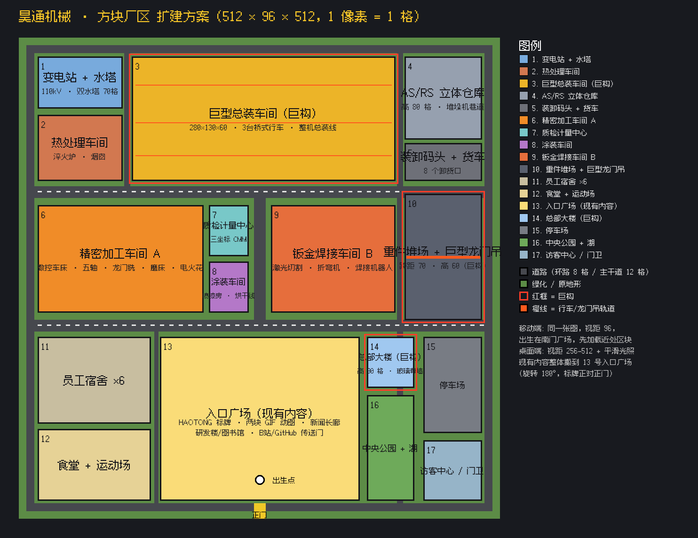

# 昊通机械 · 方块厂区（xueruo.me blockworld）交接说明

> 写给接手的下一个模型 / 开发者。整理时间：2026-10-08 11:30 左右（北京时间）。
> 原实现在 Grok Bot 的云端工作机（下称“box”）上完成，这里是完整导出。**本目录里所有内容都还没有 commit，git 由薛若米本人处理。**

## 一句话现状

- `https://xueruo.me` 现在就是一个可在浏览器里玩的复古方块世界「昊通机械 · 方块厂区」，引擎是打过补丁的 **ClassiCube 网页版**（BSD-3），世界 256×64×256。
- 原来的纸页风主页保留在 `https://xueruo.me/classic/`，书库 `library.html` 与阅读器 `read.html` 照常可用。
- 用户的**下一阶段需求**（尚未开工）：做成 **512×96×512 的巨型真实机械厂区**（17 个功能区、4 个巨构），增加约 120 种工业方块、手持工具/武器、会在厂区里操作机器的 NPC 工人和叉车、可分类打开的背包；并且**最新指示是换一个更现代、性能更好、功能更多的类 Minecraft 引擎**并做整体性能优化。换引擎的工作只开了个头（尚未选型、未改任何东西）。

## 文档索引（先读这里）

| 文档 | 内容 |
|---|---|
| [CURRENT_STATE.md](CURRENT_STATE.md) | 现在线上有什么、代码怎么组织、引擎补丁、方块/贴图预算、已知问题 |
| [DEPLOYMENT.md](DEPLOYMENT.md) | 所有环境（Cloudflare Pages 正式站 / 预览站、阿里云服务器）、部署命令、nginx 配置、回滚、密钥放在哪（不含密钥值） |
| [MASTER_PLAN.md](MASTER_PLAN.md) | 宏观规划：巨型厂区 17 区布局、巨构、新功能、**换引擎的需求与候选**、分阶段计划、验收标准、风险 |
| [HISTORY.md](HISTORY.md) | 需求与决策时间线（用户说过什么、为什么这么做、哪些被否决） |
| [ENGINE_E0.md](ENGINE_E0.md) | 本地引擎候选预览、同场景实测、角色原图与后续选择 |
| [park_layout.png](park_layout.png) | 512×512 厂区平面布局图（1 像素 = 1 格） |



## 仓库里新增的东西（`blockworld/`）

```
blockworld/
├── README.md                 本目录说明（简版）
├── gen/                      生成器：build.py（世界 + 站点）、skin.py（工程师皮肤）、index.template.html（页面模板）、shoot.py（无头截图冒烟测试）
│                              *_v1_shark.py / skin_shark_old.py / index.template.v1.html = 第一版“鲨鱼”主题，已被用户否决，仅留档
├── content/news/*.md         厂区公告（7 条真实动态，front-matter: title/date/link）
├── patches/                  ClassiCube 网页版补丁（基于 commit f40534b4）+ 应用脚本 + 说明
├── deploy/                   服务器 nginx 站点配置 + 部署说明；pages-preview/_headers、pages-prod/robots.txt
├── plan/                     PLAN.md（巨型厂区扩建方案 v1，英文要点）+ layout.py（生成 park_layout.png）
├── site/                     box 上最后一次 `gen/build.py` 的输出（本地构建产物）
├── dist_prod/                **与 xueruo.me 线上完全一致**的部署目录（已用 md5 核对）
├── classic-site/             当前线上纸页站（/classic/、书库、阅读器）的**最新源文件**（比仓库根目录那份新）
├── assets/gifs/              用户提供的两张 GIF 原图（鲨鱼帽·法棍散步、鲨鱼帽·抱猫）+ 字体许可证
├── gifs/                     a.gif / b.gif → 指向 assets/gifs 的符号链接（build.py 按这个路径读）
├── shots/                    精选截图（线上正式站、服务器版、手机版、布局图、尺寸实测、光影 PoC）
├── hq_poc_ABANDONED/         three.js 光影渲染 PoC —— **用户已明确不要光影，已废弃**，仅留档
└── rollback/ROLLBACK_INFO.txt  切换正式站前的部署 ID 记录
```

## 重要：仓库根目录那份纸页站是旧的

仓库根目录（`index.html`、`library.html`、`read.html`、`css/`、`js/`、`data/`）停在 2026-09-21 的提交 `702f66b`，**和线上不一致**：
根目录里《日课永动机》只有 1–18 章、《抽帧图书馆》只有第 1 章、《关于我只是个群聊Bot…》只有 44–46 章，`data/books.json` 也不同；
线上（= `blockworld/classic-site/`）是《日课永动机》1–40 章、《抽帧图书馆》1–30 章、《关于我只是个群聊Bot…》1–30 章，另有 `data/bibles/`、`tools/`、`ruomi.png`、`NOVEL_SOURCE_PACK.md`。
`index.html`、`library.html`、`read.html`、`css/`、`js/` 两边逐字节相同。
这次**没有覆盖根目录**，最新版放在 `blockworld/classic-site/`。是否用它替换根目录，由用户决定。

## 接手时的硬约束（用户已确认的）

1. 页面和世界里**不出现 “Minecraft” 名称或 Logo**，**不使用任何 Mojang 素材**（材质、音效、代码）。Eaglercraft 一类由 Mojang 代码转译的方案不可用。
2. 保留**文字版**（`#text`，无 WebGL / 爬虫 / 不想玩的人也能看全部动态和书目）。
3. 保留 `/classic/`、`/library.html`、`/read.html?book=<id>` 这些地址。
4. 新版本先发到**预览地址**（建议服务器上的 `/v2/` 或单独的预览 Pages 项目），**用户点头后才换正式站**。
5. 用户自己的两张 GIF 必须**原样**放进游戏（会动），点开能看原图。
6. 不要光影（用户撤回了“电脑端超高画质光影”的需求）。
7. 不要替用户 commit / push。

## 起步建议

1. 读 `CURRENT_STATE.md` 和 `MASTER_PLAN.md` 第 4 节（换引擎）。
2. 本地起一个静态服务器看现状：`cd blockworld/dist_prod && python3 -m http.server 8787`，打开 `http://127.0.0.1:8787/`。
3. 按 MASTER_PLAN 的 E0 阶段做引擎选型 PoC，把结论和实测数据发给用户确认后再大规模开工。
